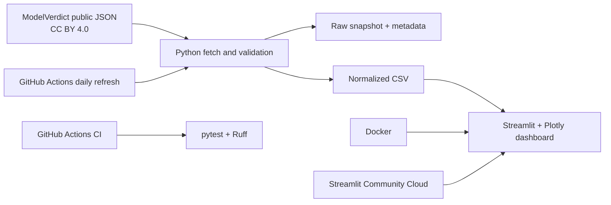

# ModelScope AI

**Task Accuracy, Cost & Response Time Explorer** — an interactive Streamlit dashboard for comparing language models on repeatable business-document tasks.

> This project reports task-specific measurements. It does not rank universal model intelligence.

## Live Demo

[Launch ModelScope AI](https://modelscope-ai.streamlit.app/)

## Features

- Filter by task, document language, document format, provider, model, accuracy, cost, and response time.
- Explore task accuracy versus actual cost per 1,000 documents.
- Highlight a Pareto frontier within the selected task/language/format cohort.
- Compare median and p90 response times and field/document accuracy.
- Review provider medians, ranked costs, and a sortable model explorer.
- Switch between light and dark appearance; refine numeric ranges inside the sidebar.
- Download the current filtered cohort with source metadata.
- Refresh the public snapshot with GitHub Actions; run locally or in Docker.

## Data source and interpretation

The dashboard uses ModelVerdict's published leaderboard JSON. Its open-data page licenses the published results under **CC BY 4.0** and asks users to credit ModelVerdict with a link. The app and exported rows retain that attribution.

The source evaluates six business-document workflows, including invoice extraction, email triage, personal-data detection, contract-term extraction, summarization, and document question answering. It records the share of fields correct, the share of documents without errors, actual token spend scaled to 1,000 documents, and p50/p90 end-to-end response time. The dashboard compares models only inside one task, language, and document-format cohort at a time.

These results are not a general intelligence score. Latency is whole-response time, not time-to-first-token or output tokens per second. ModelScope AI is an independent educational analysis and is not endorsed by ModelVerdict.

- [Open data and license](https://modelverdict.ai/en/data/)
- [Measurement methodology](https://modelverdict.ai/en/methodology/)
- [Published JSON snapshot](https://modelverdict.ai/data/leaderboards.json)

## Architecture



## Tech stack

Python · Streamlit · Plotly · Pandas · Requests · pytest · Ruff · Docker · GitHub Actions · Streamlit Community Cloud

## Local installation

Requirements: Python 3.12+.

```bash
git clone https://github.com/iovargasjeff/ModelScope-AI.git
cd ModelScope-AI
python -m venv .venv
```

Activate the environment, then install dependencies and fetch the first snapshot:

```bash
# Windows PowerShell
.\.venv\Scripts\Activate.ps1

# macOS / Linux
source .venv/bin/activate

pip install -r requirements-dev.txt
python scripts/fetch_data.py
streamlit run app.py
```

The fetch script validates the source license, schema, and non-empty data before updating the checked-in snapshot. A failed fetch never replaces the last valid snapshot. Re-running against the same source run leaves the files unchanged.

## Docker

Docker and Docker Compose are included for reproducible local use:

```bash
docker compose up --build
```

Open <http://localhost:8501>. Refresh the snapshot from the built image with:

```bash
docker compose run --rm app python scripts/fetch_data.py
```

## Automated workflows

- **CI** runs on pushes and pull requests to `main`: Ruff, pytest, and Python bytecode compilation.
- **Data refresh** runs daily and on manual dispatch. It validates the new source run and commits only when the source `run_id` changes. The workflow needs `contents: write` and no API key.

The data refresh schedule is more frequent than the source's weekly publication cadence; unchanged runs produce no commit.

## Deploying on Streamlit Community Cloud

1. Push this repository to GitHub.
2. Sign in to [Streamlit Community Cloud](https://share.streamlit.io) and choose **Create app**.
3. Select `iovargasjeff/ModelScope-AI`, branch `main`, and entry point `app.py`.
4. Deploy. The app uses the tracked snapshot and does not require secrets.

Community Cloud watches the connected branch and updates the app when new commits arrive.

## Repository structure

```text
ModelScope-AI/
├── app.py
├── data/
│   ├── leaderboards.json
│   ├── metadata.json
│   └── models.csv
├── scripts/fetch_data.py
├── src/
│   ├── charts.py
│   ├── data_loader.py
│   ├── data_processing.py
│   └── metrics.py
├── tests/
├── articles/
├── submission/links.txt
├── .github/workflows/
├── Dockerfile
├── docker-compose.yml
└── README.md
```

## Reproducibility and tests

```bash
pip install -r requirements-dev.txt
pytest
ruff check app.py src scripts tests
```

Unit tests use small synthetic rows only to verify transformations and calculations. They are not included in the dashboard snapshot and do not represent observed model performance.

## Attribution and disclaimer

Dashboard data: **ModelVerdict**, licensed under **CC BY 4.0**. Credit: [ModelVerdict](https://modelverdict.ai). ModelScope AI's charts and analysis are created independently and do not imply endorsement by the source.

Benchmark scores are tied to the source's prompts, synthetic document set, model versions, provider settings, language, format, and run date. They do not guarantee performance on other data or tasks. For very close scores, review the source methodology and sample size.

## Preview

The public dashboard is available at [modelscope-ai.streamlit.app](https://modelscope-ai.streamlit.app/).
